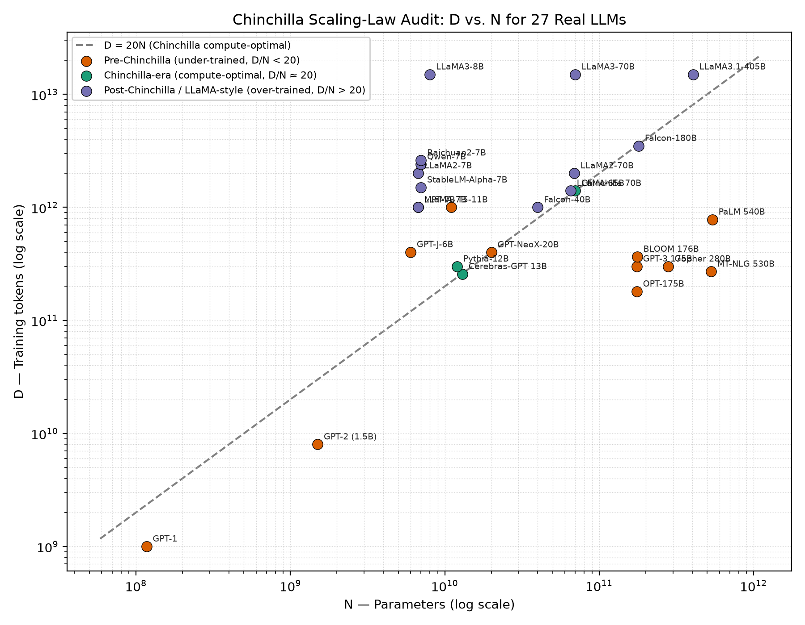

# Chinchilla Scaling-Law Audit

How well do real large language models follow the **Chinchilla compute-optimal
rule** — roughly **20 training tokens per parameter** (`D ≈ 20N`,
[Hoffmann et al., 2022](https://arxiv.org/abs/2203.15556))?

This project collects the reported parameter count **N** and training-token count
**D** for **27 real, publicly documented LLMs** (2018–2024), computes each model's
`D/N` ratio, and plots them against the `D = 20N` reference line to show three
distinct eras of scaling practice.



## Why this matters

The Chinchilla paper showed that, for a fixed compute budget, many early large
models (GPT-3, Gopher, MT-NLG) were **badly under-trained** — too many parameters,
too few tokens. After it, the LLaMA family went the other way, deliberately
**over-training** small models on far more than `20N` tokens to make them cheaper
to *run* (inference cost scales with N, not D). This audit makes that shift
visible on a single log-log chart, using each model's own published numbers.

## Key findings (computed from the data)

Median tokens-per-parameter (`D/N`) by era, across the 27 models:

| Era | Models | Median `D/N` | Min | Max |
|-----|:---:|:---:|:---:|:---:|
| **Pre-Chinchilla** (under-trained) | 11 | **2.1** | 0.5 | 90.9 |
| **Chinchilla-era** (compute-optimal, ≈20) | 3 | **20.0** | 19.8 | 25.0 |
| **Post-Chinchilla / LLaMA-style** (over-trained) | 13 | **149.3** | 19.4 | 1875.0 |

- **Most under-trained:** MT-NLG 530B (`D/N = 0.5`), OPT-175B (1.0), Gopher 280B (1.1),
  PaLM 540B (1.4), GPT-3 175B (1.7) — all the giant 2020–2022 models.
- **Most over-trained:** LLaMA3-8B (`D/N = 1875`), Baichuan2-7B (371), Qwen-7B (343),
  LLaMA2-7B (299), LLaMA3-70B (214) — modern small models trained on trillions of tokens.
- The three **Chinchilla-era** models (Chinchilla 70B, Cerebras-GPT 13B, Pythia-12B)
  sit almost exactly on `D = 20N`, as expected — two of them were *explicitly* built
  to that recipe.

The clean takeaway: the compute-optimal `20N` line is a narrow band that most
famous models **miss on purpose**, in opposite directions and for opposite reasons
(training compute vs. inference cost).

## Data

`N` and `D` are each model's **own reported figures**, taken from the paper, model
card or official blog (every row in [`chinchilla_audit_results.csv`](chinchilla_audit_results.csv)
carries a `source_url` and a `note`). Where a source didn't publish an exact token
count (e.g. GPT-1, GPT-2), the value is a clearly-marked estimate from the described
corpus size. No figures are invented.

The script runs **three sanity checks** on the table before plotting, to catch the
most common failure mode in this kind of audit — a million/billion/trillion unit
slip — by asserting `N`, `D` and `D/N` all fall in plausible ranges.

## Repository layout

```
experiment_scaling_law_audit.py   # the full experiment: dataset, computation, plot
chinchilla_audit_results.csv       # generated: 27 models + computed D/N, log10 cols
chinchilla_audit_plot.png          # generated: log-log D vs N with the D=20N line
Scaling_Law_Audit_Report.pdf       # written report with discussion
requirements.txt
```

## Reproduce

```bash
python3 -m venv .venv && source .venv/bin/activate
pip install -r requirements.txt
python experiment_scaling_law_audit.py
```

This regenerates `chinchilla_audit_results.csv` and `chinchilla_audit_plot.png`
and prints the per-era summary and the most over-/under-trained models. The
computation is fully offline — the model figures are hard-coded from their sources,
so there are no downloads or API calls.

## Limitations

- `N` mixes total vs. non-embedding parameter counts depending on what each source
  reported; at log scale this doesn't change the picture, but exact `D/N` values
  carry that caveat.
- A handful of token counts are estimates (flagged in the `note` column).
- 27 models is an illustrative cross-section, not an exhaustive census.

## License

[MIT](LICENSE) © Anson Dias
